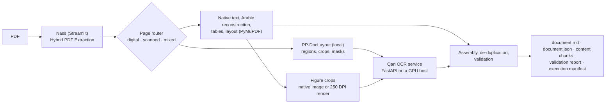

# Nass

**Intelligent PDF Content Extraction**

Nass is an AI-powered platform that extracts the complete content of Arabic and English PDFs (body text, tables, charts, KPI cards, screenshots and scanned pages) into clean, validated and structured output, with every value traceable to its page, region and source image.

Nass combines three things:

- **Native PDF extraction** where the text layer is reliable, including Arabic logical-order reconstruction.
- **Layout analysis** with PP-DocLayout, to find figures, tables and text blocks on scanned pages.
- **OCR** with Qari, a vision-language OCR model specialized for Arabic, used only where it is needed.

Uncertain values are flagged for review; they are never estimated or "corrected".

## Key features

- **One-button Automatic Extraction:** upload a PDF, click once, review the result and download it.
- **Digital, scanned and mixed PDFs:** each page is classified automatically and processed by the right path, with the rule and evidence recorded.
- **Native text extraction:**
  - PyMuPDF text;
  - Arabic reading-order reconstruction, including numbers and Latin text inside right-to-left lines;
  - layout-aware Markdown with headings, lists and reading order.
- **Tables:** detected from the PDF structure, including tables that continue across pages, and exported as Markdown and as cell data.
- **Charts, tables and images:**
  - visuals are cropped at native resolution, or rendered at 250 DPI when a figure is built from several PDF objects;
  - each visual is read by Qari.
- **Scanned pages:** PP-DocLayout layout detection, a crop per visual, and a full-page reading with the visuals masked, so figure content is never duplicated in the body text.
- **Validation:**
  - number formats and units;
  - Arabic-Indic digit checks, with an optional second reading;
  - cross-source duplicate detection;
  - a review queue with on-demand processing.
- **Structured exports:** Markdown, JSON with element-level provenance, JSON Lines content chunks, a validation report, an execution manifest and a ZIP package.
- **Reproducible runs:**
  - SHA-256 of every input and crop, and the raw OCR attempts;
  - write-once run folders;
  - interrupted runs can be resumed, and pending OCR jobs can be exported for offline processing.
- **Evaluation tools:** extractor comparison, Ground Truth scoring, a text-layer benchmark, and an OCR/VLM evaluation console.

## Supported PDFs

| Type | Processing |
| --- | --- |
| **Digital** (for example Word or Office exports) | Native text, tables and layout; figures are read by Qari |
| **Scanned** | Layout detection, a crop per visual read by Qari, and a masked full-page read for the body text |
| **Mixed** | Native text, with OCR of raster regions; large embedded scans are processed like scanned pages |

## Arabic and English

- Arabic pages are detected from their letter share and read right to left.
- Arabic text in the PDF layer is reconstructed into logical order. Words split by spacing are rejoined only when OCR confirms them.
- Arabic-Indic, Persian and Western digits are compared by value, with Arabic thousands (`٬`) and decimal (`٫`) separators kept. The extracted text itself is never rewritten.

## Architecture



Everything except OCR inference runs on your machine. The Qari service runs on any CUDA GPU host you control, for example a cloud GPU pod or an internal server.

## Technology

| Area | Stack |
| --- | --- |
| Application | Python 3.12, Streamlit (bound to `127.0.0.1`, usage statistics off) |
| PDF | PyMuPDF; pypdfium2, pdfplumber and pypdf for comparisons |
| Layout | PaddleOCR `LayoutDetection` with **PP-DocLayout_plus-L** |
| OCR | **Qari-OCR 0.4.0** (`NAMAA-Space/Qari-OCR-0.4.0-VL-4B-Instruct`), a PEFT adapter on `Qwen/Qwen3-VL-4B-Instruct`, run with PyTorch and transformers |
| OCR service | FastAPI and Uvicorn |
| Client and configuration | httpx, pydantic, Pillow |

## Installation

Python 3.12 is recommended; Nass was developed and validated on Windows.

```bash
python -m venv .venv
# Windows: .venv\Scripts\activate     Linux/macOS: source .venv/bin/activate
pip install -r requirements.txt
```

**Scanned-page support (PP-DocLayout).** Install PaddlePaddle first (CPU or GPU; see `requirements-doclayout.txt`), then:

```bash
pip install -r requirements-doclayout.txt
```

**PP-DocLayout model.** Nass never downloads models. Download and unpack the official package once:

```
https://paddle-model-ecology.bj.bcebos.com/paddlex/official_inference_model/paddle3.0.0/PP-DocLayout_plus-L_infer.tar
```

Then set `LAYOUT_MODEL_DIR` to the unpacked folder, which contains `inference.yml`, `inference.json` and `inference.pdiparams`.

## Configuration

Copy `.env.example` to `.env` in the repository root and edit it. Real environment variables take precedence over `.env`, and `.env` is git-ignored.

| Variable | Purpose |
| --- | --- |
| `QARI_SERVICE_URL`, `QARI_SERVICE_TOKEN` | Qari service base URL and bearer token |
| `QARI_DEPLOYMENT_MODE` | `local` (loopback only, the default), `internal` (company server, no public IPs) or `development_external` (https, plus an explicit host allowlist) |
| `QARI_TRUSTED_DEV_HOSTS` | Exact host names allowed in `development_external` mode |
| `LAYOUT_MODEL_DIR`, `LAYOUT_DEVICE` | PP-DocLayout folder and device (`cpu`, `gpu:0`) |
| `AGENTICDOC_RESULTS_DIR` | Where run folders are written (default `~/agenticdoc/results`) |
| `VERIFY_DIGITS_ENABLED`, `VERIFY_DIGITS_MAX_REQUESTS` | Optional second reading of Arabic-Indic digits, with a per-run limit |

`.env.example` documents every variable. `lab/config/auto_extraction.toml` holds the operational defaults; the validated extraction settings are fixed in code and recorded in every run.

## Qari OCR service

`runpod/qari_service.py` serves Qari with a fixed, validated recipe:

- prompt `Free OCR.`, greedy decoding, `max_new_tokens=1536`;
- a time limit of 30 s per crop and 60 s per page;
- an in-generation repetition stopper, then one retry with `repetition_penalty=1.1`;
- every attempt is returned.

The service loads the model once, requires a bearer token, and exposes:

| Endpoint | Purpose |
| --- | --- |
| `GET /health` | Status; no secrets |
| `POST /v1/ocr` | OCR one image |
| `GET /v1/results/{request_id}` | Recover a result whose response was lost |

```bash
pip install -r runpod/requirements-qari-service.txt     # after installing a CUDA build of PyTorch
export QARI_SERVICE_TOKEN='<long random token>'
cd runpod
uvicorn qari_service:app_from_environment --factory --host 0.0.0.0 --port 8000 --workers 1
```

A GPU with about 24 GB of VRAM is recommended (developed on an RTX 4090). On a RunPod GPU pod:

1. Expose HTTP port 8000.
2. Set `QARI_SERVICE_URL=https://<pod-id>-8000.proxy.runpod.net` and `QARI_TRUSTED_DEV_HOSTS=<pod-id>-8000.proxy.runpod.net`.
3. Use `QARI_DEPLOYMENT_MODE=development_external`.

Attach persistent storage if you want to keep the model cache between pods. Without a reachable service, runs are planned and paused, and `runpod/qari_offline_batch.py` can process an exported job folder offline.

## Running Nass

```bash
python -m lab.launch
```

The launcher binds Streamlit to `127.0.0.1` with usage statistics disabled. Create a workspace on **Home**, then open the sections in the sidebar:

| Section | Purpose |
| --- | --- |
| **Hybrid PDF Extraction** | The final, integrated extraction section, with two modes: **Automatic Extraction** and **Benchmark Mode** |
| Documents, Run Text Extraction, Compare, Ground Truth, Results and Export | Native text extractor comparison and Ground Truth tooling |
| OCR VLM Evaluation | Evaluation console for local and hosted OCR/VLM models; hosted calls need explicit authorization |
| Local PDF Extraction Benchmark | Text-layer library benchmark with Arabic reconstruction and tables |

**Hybrid PDF Extraction** brings together every extraction component of Nass:

- the page router;
- native text and Arabic reconstruction;
- tables and layout;
- PP-DocLayout, figure cropping and masking;
- Qari OCR, validation and assembly.

It offers two modes:

- **Automatic Extraction** applies the validated configuration end to end.
- **Benchmark Mode** exposes every step for evaluation: page analysis, model choice, approvals, region sets and provider comparison.

## Using Automatic Extraction

1. Open **Hybrid PDF Extraction** and keep Mode **Automatic Extraction**.
2. Choose or upload a PDF.
3. Check the status lines (layout model ready, Qari endpoint trusted) and click **Check Qari service**.
4. Click **Automatic Extraction**. Nass plans locally, sends the prepared images to Qari, and finalizes the run.
5. Review the results:
   - the classification of each page;
   - the review queue (use **Process now** for regions that were not processed automatically);
   - validation warnings;
   - the document preview.
6. Click **Prepare ZIP**, then **Download ZIP**.

Runs are resumable. **Resume**, **Recover**, **Retry** and offline import are available in the run view.

## Outputs

Each run is a write-once folder, `<results>/automatic_extraction/run_<timestamp>_<id>/`:

| File | Content |
| --- | --- |
| `document.md` | Readable document in reading order |
| `document.json` | Elements with page, type, bounding box, content, source, model, validation state and provenance; tables as Markdown plus cells |
| `rag_chunks.jsonl` | Content chunks (JSON Lines), with document hash, page, element id, bounding box and validation state, ready for indexing and downstream processing |
| `validation_report.json` | All flags, the duplicate check and the digit verification |
| `execution_manifest.json` | Configuration, routing, masking, crop provenance, OCR service audit and checksums |
| `crops/`, `pages/`, `raw/`, `plan/` | Exact images sent, original page images, raw OCR attempts and the plan |

To compare two runs, read-only: `python -m lab.core.auto.compare <run A> <run B>`.

## Project status

- **Automatic Extraction** is the stable extraction workflow, validated end to end on Arabic digital, scanned and Office-exported reports, with Qari on a remote GPU.
- **Benchmark Mode** and the evaluation sections are tools for measuring and comparing extraction quality.
- The OCR service is provided as a development-ready FastAPI application. A hardened production deployment (TLS termination, scaling and monitoring) is left to the deploying organization.

## License

Nass is licensed under the **GNU Affero General Public License, version 3 only** (AGPL-3.0-only). The full text is in [`LICENSE`](LICENSE).

```
SPDX-License-Identifier: AGPL-3.0-only
```

The AGPL-3.0 adds one obligation to the GPL-3.0 (section 13). If you modify Nass and let users interact with it over a network, you must offer those users the Corresponding Source of your modified version.

Nass is distributed without any warranty; see sections 15 and 16 of the license.

Third-party components have their own licenses. In particular:

- **PyMuPDF is AGPL-3.0** (or commercial);
- PaddlePaddle and PaddleOCR, Streamlit, transformers and the other libraries each have their own terms;
- the Qwen3-VL base model and the Qari-OCR adapter are distributed under the licenses on their model cards.

Review these terms before redistributing.
